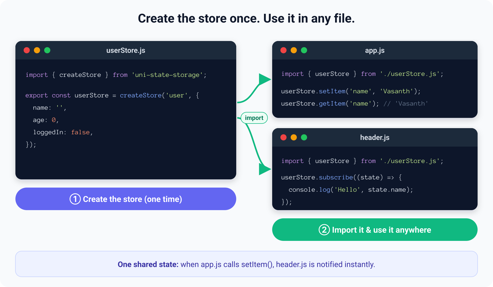

# uni-state-storage

**Universal state management + storage for JavaScript and TypeScript.** One tiny store, a simple API, and zero dependencies.

[GitHub](https://github.com/vasanthakumar2k/universal-state-storage) · [Report an issue](https://github.com/vasanthakumar2k/universal-state-storage/issues) · [npm](https://www.npmjs.com/package/uni-state-storage)

> **Status: pre-release (0.1.0, core engine only).** In-memory state management is implemented and tested. Persistent storage (localStorage, AsyncStorage, MMKV), React hooks and storage adapters are in progress and **not available yet**. See [docs/ROADMAP.md](https://github.com/vasanthakumar2k/universal-state-storage/blob/main/docs/ROADMAP.md). This README documents only what works today.

## Install

```bash
npm install uni-state-storage
```

## How to use it: two files

You **create a store once** in its own file, then **import it in any file** that needs the data.



### Step 1: create the store (`userStore.js`)

```js
// userStore.js
import { createStore } from 'uni-state-storage';

export const userStore = createStore('user', {
  name: '',
  age: 0,
  loggedIn: false,
});
```

### Step 2: use it anywhere (`app.js`)

```js
// app.js
import { userStore } from './userStore.js';

userStore.setItem('name', 'Vasanth');   // update one property
userStore.getItem('name');              // 'Vasanth'

userStore.set({ name: 'Vasanth', age: 25, loggedIn: true }); // replace whole state
userStore.update((s) => ({ ...s, age: s.age + 1 }));         // change based on old state

userStore.removeItem('loggedIn');       // delete one property
userStore.clear();                      // back to the initial state
userStore.get();                        // { name: '', age: 0, loggedIn: false }
```

### Step 3: react to changes (`header.js`)

```js
// header.js
import { userStore } from './userStore.js';

const unsubscribe = userStore.subscribe((state, prevState) => {
  console.log('Hello', state.name);
});

unsubscribe(); // stop listening
```

## What happens when you update


Updates are **synchronous**: `get()` shows the new value on the very next line, and every subscriber has already run before `setItem()` returns.

## Try it: run the demo app

The repo includes a working example in [`examples/vanilla-js/`](https://github.com/vasanthakumar2k/universal-state-storage/tree/main/examples/vanilla-js): `userStore.js` creates the stores and `app.js` uses them and checks every method.

```bash
npm install
npm run demo
```

Expected output:

```text
── uni-state-storage demo ──

✅ get() returns the initial state
✅ setItem('name', 'Vasanth')
...
14 passed, 0 failed
```

## Listen to only one property

Pass a selector so your callback runs only when that part of the state changes:

```js
import { createStore, shallow } from 'uni-state-storage';

const user = createStore('user', { name: '', age: 0, loggedIn: false });

// Runs only when `name` changes, not when `age` or `loggedIn` change.
user.subscribe((s) => s.name, (name, prevName) => console.log(name));

// Selecting an object? Pass `shallow` so a new-but-equal object doesn't fire.
user.subscribe((s) => ({ name: s.name, age: s.age }), (v) => console.log(v), shallow);
```

## API

| Method | What it does |
| --- | --- |
| `createStore(name, initialState, options?)` | Creates a store. `initialState` can be any value except `undefined`. |
| `get()` | Returns the whole current state. Treat it as read-only. |
| `set(next \| prev => next)` | Replaces the whole state. Doesn't merge. |
| `update(prev => next)` | Replaces the state with what your function returns. |
| `getItem(key)` | Reads one property (object state only). |
| `setItem(key, value \| prev => next)` | Sets one property (object state only). |
| `removeItem(key)` | Deletes one property. Does nothing if the key isn't there. |
| `clear()` | Resets to the initial state. |
| `getInitialState()` | Returns the initial state. |
| `subscribe(listener)` | `listener(state, prevState)` runs on every change. Returns an unsubscribe function. |
| `subscribe(selector, listener, equalityFn?)` | `listener(selected, prevSelected)` runs only when the selected value changes. |
| `ready()` | Promise that resolves when the store is ready. Immediate for in-memory stores. |
| `name` | The store's name. |
| `shallow(a, b)` | One-level equality check for objects and arrays. |

**Options**

- `onError(error)`: receives errors thrown by subscribers. Without it, the first subscriber error is re-thrown from the call that changed the state, *after* the state has been saved in memory and every other subscriber has run.

## TypeScript

Types are inferred from the initial state, so wrong keys and wrong value types are caught at compile time:

```ts
import { createStore } from 'uni-state-storage';

const user = createStore('user', { name: '', age: 0 });

user.setItem('age', 26);       // ✅
user.setItem('age', 'old');    // ❌ Type 'string' is not assignable to type 'number'
user.setItem('email', 'x');    // ❌ 'email' is not a key of the state

// Keys you plan to remove should be optional:
const auth = createStore<{ token?: string }>('auth', {});
auth.removeItem('token');
```

## Good to know

- Setting a value that's equal to the current one (`Object.is`) does nothing and notifies no one.
- Updater functions must return the next state. Returning `undefined` throws and leaves the state unchanged.
- `getItem`, `setItem` and `removeItem` need the state to be a plain object.
- To store a function as a value, wrap it: `setItem('onDone', () => myFn)`.
- Every store is independent. Changing one never affects another.

## Contributing

Issues and pull requests are welcome on [GitHub](https://github.com/vasanthakumar2k/universal-state-storage).

## License

MIT © vasanthakumar2k
"# universal-state-storage" 
"# universal-state-storage" 
