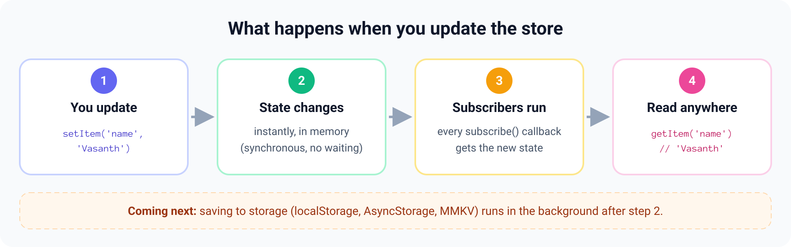

# uni-state-storage

**Universal state management + storage for JavaScript and TypeScript.** One tiny store, a simple API, and zero dependencies.

[GitHub](https://github.com/vasanthakumar2k/universal-state-storage) · [Report an issue](https://github.com/vasanthakumar2k/universal-state-storage/issues) · [npm](https://www.npmjs.com/package/uni-state-storage)

> **Status:** in-memory stores and **persistent stores** (`createStore.persist`) work on web, React Native (Android and iOS) and Node. React hooks and extra adapters are still planned. See [docs/ROADMAP.md](https://github.com/vasanthakumar2k/universal-state-storage/blob/main/docs/ROADMAP.md). This README documents only what works today.

## Contents

[Install](#install) · [How to use it](#how-to-use-it-two-files) · [Save data on the device (persist)](#save-data-on-the-device-persist) · [Web](#web) · [Android and iOS](#android-and-ios-react-native) · [Persist options](#persist-options) · [Listen to one property](#listen-to-only-one-property) · [API](#api) · [TypeScript](#typescript) · [Good to know](#good-to-know)

## Install

```bash
npm install uni-state-storage
```

## How to use it: two files

You **create a store once** in its own file, then **import it in any file** that needs the data.


### Step 1: create the store (`userStore.js`)

```js
// userStore.js
import { createStore } from 'uni-state-storage';

export const userStore = createStore('user', {
  name: '',
  age: 0,
  loggedIn: false,
});
```

### Step 2: use it anywhere (`app.js`)

```js
// app.js
import { userStore } from './userStore.js';

userStore.setItem('name', 'Vasanth');   // update one property
userStore.getItem('name');              // 'Vasanth'

userStore.set({ name: 'Vasanth', age: 25, loggedIn: true }); // replace whole state
userStore.update((s) => ({ ...s, age: s.age + 1 }));         // change based on old state

userStore.removeItem('loggedIn');       // delete one property
userStore.clear();                      // back to the initial state
userStore.get();                        // { name: '', age: 0, loggedIn: false }
```

### Step 3: react to changes (`header.js`)

```js
// header.js
import { userStore } from './userStore.js';

const unsubscribe = userStore.subscribe((state, prevState) => {
  console.log('Hello', state.name);
});

unsubscribe(); // stop listening
```

## What happens when you update



Updates are **synchronous**: `get()` shows the new value on the very next line, and every subscriber has already run before `setItem()` returns.

## Save data on the device (persist)

Want the data to **survive a page refresh or an app restart**? Use `createStore.persist` instead of `createStore`. Everything else (`setItem`, `getItem`, `update`, `subscribe`, ...) works exactly the same.

```js
// persistedStores.js
import { createStore } from 'uni-state-storage';

export const userStore = createStore.persist('user', {
  name: '',
  age: 0,
  loggedIn: false,
});

// A guest cart, saved before the user logs in
export const cartStore = createStore.persist('cart', { items: [] });
```

```js
// persistedApp.js
import { userStore, cartStore } from './persistedStores.js';

userStore.setItem('name', 'Vasanth');           // saved automatically
cartStore.update((s) => ({ ...s, items: [...s.items, { id: 1, qty: 2 }] }));
```

Next time the store is created (page reload, app relaunch), it starts with the saved data instead of the initial values.

**How it behaves**

- **Instant.** Updates change the in-memory state immediately. Saving happens right after, and many updates in the same tick become one write, so your app never waits on storage.
- **Loaded right away on web.** With `localStorage` (and MMKV) the saved data is already in `get()` the moment the store is created. With async storage (AsyncStorage), call `await store.ready()` first.
- **New keys are safe.** If you add a property to the initial state later, old saved data gets the default for it.
- **`clear()`** resets to the initial state *and* deletes the saved copy.
- **Safe on failure.** A full disk, blocked storage or corrupt data never crashes your app or loses the in-memory state. The error goes to `onError` (or `console.warn`).
- **No storage available** (server-side rendering, blocked storage)? The store still works, in memory only.

### Web

Nothing to configure. Browsers use `localStorage`, with the store name as the key. Open DevTools → Application → Local Storage to see it:

```text
user  →  {"v":0,"state":{"name":"Vasanth","age":0,"loggedIn":false}}
```

### Android and iOS (React Native)

React Native has no `localStorage`, so tell the package which storage to use. Do it **once, at the very start of your app, before any store is created**:

```ts
// index.js (first lines, before importing App)
import AsyncStorage from '@react-native-async-storage/async-storage';
import { setDefaultStorage } from 'uni-state-storage';

setDefaultStorage(AsyncStorage);
```

Then write your stores exactly as on the web. Because AsyncStorage is async, wait for `ready()` before showing screens that need the data:

```ts
await userStore.ready(); // saved data is now loaded (e.g. keep the splash screen up until then)
```

Prefer MMKV (faster, and synchronous like `localStorage`)?

```ts
import { MMKV } from 'react-native-mmkv';
import { setDefaultStorage, mmkvAdapter } from 'uni-state-storage';

setDefaultStorage(mmkvAdapter(new MMKV()));
```

`@react-native-async-storage/async-storage` and `react-native-mmkv` are installed in *your* app. `uni-state-storage` itself still has zero dependencies. If you forget `setDefaultStorage` on React Native, the package prints a warning instead of silently losing data.

You can also give one store its own storage: `createStore.persist('user', init, { storage: AsyncStorage })`.

### Persist options

```js
import { createStore } from 'uni-state-storage';

export const accountStore = createStore.persist(
  'account',
  { name: '', token: '', theme: 'light' },
  {
    key: 'my-app-account',                   // storage key (default: the store name)
    partialize: (s) => ({ name: s.name, theme: s.theme }), // save only these; the token is NOT saved
    version: 2,                              // bump when the saved shape changes
    migrate: (saved, savedVersion) => ({ ...saved }), // convert data saved by an older version
    onError: (error) => console.log('storage problem', error),
  },
);
```

| Option | What it does |
| --- | --- |
| `storage` | Where to save. Default: `localStorage`, or whatever you passed to `setDefaultStorage`. Any object with `getItem`, `setItem`, `removeItem` works, sync or async. |
| `key` | Storage key. Default: the store name. |
| `partialize(state)` | Choose what gets saved. Use it to keep secrets such as tokens out of storage. |
| `version` | Number for the saved shape. Default `0`. |
| `migrate(saved, savedVersion)` | Converts data saved under another `version`. Without it, data from another version is ignored and the store starts from its initial state. |
| `onError(error)` | Receives storage errors and subscriber errors. |

> **Security:** `localStorage`, AsyncStorage and MMKV are not encrypted. Don't persist passwords or long-lived secrets. Use `partialize` to leave them out, and a secure keystore for tokens.

> **Server-side rendering (Next.js, etc.):** on the server the store runs in memory with its initial values, and the browser loads saved data when the page starts. If a server-rendered component shows saved values on the first render, you may see a hydration mismatch. Read persisted values after mount (for example in `useEffect`).

## Try it: run the demo app

The repo includes a working example in [`examples/vanilla-js/`](https://github.com/vasanthakumar2k/universal-state-storage/tree/main/examples/vanilla-js): `userStore.js` creates the stores and `app.js` uses them and checks every method.

```bash
npm install
npm run demo
```

Expected output:

```text
── uni-state-storage demo ──

✅ get() returns the initial state
✅ setItem('name', 'Vasanth')
...
14 passed, 0 failed
```

## Listen to only one property

Pass a selector so your callback runs only when that part of the state changes:

```js
import { createStore, shallow } from 'uni-state-storage';

const user = createStore('user', { name: '', age: 0, loggedIn: false });

// Runs only when `name` changes, not when `age` or `loggedIn` change.
user.subscribe((s) => s.name, (name, prevName) => console.log(name));

// Selecting an object? Pass `shallow` so a new-but-equal object doesn't fire.
user.subscribe((s) => ({ name: s.name, age: s.age }), (v) => console.log(v), shallow);
```

## API

| Method | What it does |
| --- | --- |
| `createStore(name, initialState, options?)` | Creates an in-memory store. `initialState` can be any value except `undefined`. |
| `createStore.persist(name, initialState, options?)` | Same, but saved to `localStorage` / AsyncStorage / MMKV and restored on the next start. See [persist options](#persist-options). |
| `setDefaultStorage(storage)` | Sets the storage used by every `createStore.persist` (needed once on React Native). |
| `mmkvAdapter(mmkv)` | Wraps a `react-native-mmkv` instance so it can be used as storage. |
| `get()` | Returns the whole current state. Treat it as read-only. |
| `set(next \| prev => next)` | Replaces the whole state. Doesn't merge. |
| `update(prev => next)` | Replaces the state with what your function returns. |
| `getItem(key)` | Reads one property (object state only). |
| `setItem(key, value \| prev => next)` | Sets one property (object state only). |
| `removeItem(key)` | Deletes one property. Does nothing if the key isn't there. |
| `clear()` | Resets to the initial state. On a persisted store it also deletes the saved copy. |
| `getInitialState()` | Returns the initial state. |
| `subscribe(listener)` | `listener(state, prevState)` runs on every change. Returns an unsubscribe function. |
| `subscribe(selector, listener, equalityFn?)` | `listener(selected, prevSelected)` runs only when the selected value changes. |
| `ready()` | Promise that resolves when the store is ready. Immediate for in-memory stores; for persisted stores it resolves once the saved data is loaded. |
| `name` | The store's name. |
| `shallow(a, b)` | One-level equality check for objects and arrays. |

**Options**

- `onError(error)`: receives errors thrown by subscribers. Without it, the first subscriber error is re-thrown from the call that changed the state, *after* the state has been saved in memory and every other subscriber has run.

`createStore.persist` accepts the same option plus `storage`, `key`, `partialize`, `version` and `migrate` (see [persist options](#persist-options)).

## TypeScript

Types are inferred from the initial state, so wrong keys and wrong value types are caught at compile time:

```ts
import { createStore } from 'uni-state-storage';

const user = createStore('user', { name: '', age: 0 });

user.setItem('age', 26);       // ✅
user.setItem('age', 'old');    // ❌ Type 'string' is not assignable to type 'number'
user.setItem('email', 'x');    // ❌ 'email' is not a key of the state

// Keys you plan to remove should be optional:
const auth = createStore<{ token?: string }>('auth', {});
auth.removeItem('token');
```

## Good to know

- Setting a value that's equal to the current one (`Object.is`) does nothing and notifies no one.
- Updater functions must return the next state. Returning `undefined` throws and leaves the state unchanged.
- `getItem`, `setItem` and `removeItem` need the state to be a plain object.
- To store a function as a value, wrap it: `setItem('onDone', () => myFn)`.
- Every store is independent. Changing one never affects another.
- Persisted data is stored as JSON, so state should be JSON-friendly (strings, numbers, booleans, arrays, plain objects). `Date`, `Map`, `Set` and functions don't survive a save and reload.
- Changes made in one browser tab are not pushed live to other open tabs; they appear when a tab loads the store.
- Two persisted stores with the same name (or `key`) share one saved entry. Give each store its own name.

## Contributing

Issues and pull requests are welcome on [GitHub](https://github.com/vasanthakumar2k/universal-state-storage).

## License

MIT © vasanthakumar2k
